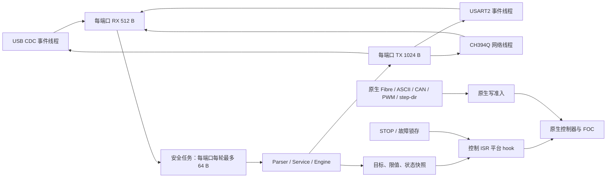

# V1.2 单轴固件架构与并发约束

本文对应仓库中的 ODrive 0.5.6 扩展实现，核对日期为 2026-10-04。所有源码链接均相对于本文。该实现保留原生电流环、编码器处理和轴状态机，在其外围增加训练状态机、控制权仲裁、协议、传感器和平台保护。当前硬件验收声明尚未满足，实际电机和制动输出被编译期硬件锁阻止；主机测试与 ARM 构建不构成上板验收。

## 代码分层与数据流

| 层 | 实现 | 职责 |
|---|---|---|
| 原生控制 | [MotorControl](../../Firmware/MotorControl) | FOC、原生控制器、编码器、校准、轴状态机；固定位置调用平台 hook |
| 板级 | [Board/rehab_v12](../../Firmware/Board/rehab_v12) | 单轴对象、引脚、ADC、定时器、DMA、中断、启动与链接布局 |
| 平台 | [runtime.cpp](../../Firmware/Rehab/platform/runtime.cpp) | 所有权、目标发布、即时失能、快环保护、线程与通信队列 |
| 训练核心 | [engine.hpp](../../Firmware/Rehab/core/engine.hpp)、[engine.cpp](../../Firmware/Rehab/core/engine.cpp) | 不依赖 HAL/RTOS 的状态、参数、训练模式、力处理与统计 |
| 协议 | [frame.cpp](../../Firmware/Rehab/protocol/frame.cpp)、[service.cpp](../../Firmware/Rehab/protocol/service.cpp) | CRC/组帧、会话、去重、命令验证、结果码 |
| 外设 | [drivers](../../Firmware/Rehab/drivers) | HX711、CH394Q、V1.2 专用 SPI 仲裁与有限恢复 |

训练协议端口编号固定为 USB CDC=0、USART2=1、CH394Q TCP=2。USB 原生 Fibre 接口仍由原生 USB 线程处理，USB CDC 在启用扩展协议时使用 Rehab 帧；UART 根据所选协议启动原生 Fibre、ASCII 或 Rehab，单个字节流不会混用 Rehab 与 ASCII/stdout。通信适配见 [stream.cpp](../../Firmware/Rehab/platform/stream.cpp)、[interface_usb.cpp](../../Firmware/communication/interface_usb.cpp)、[interface_uart.cpp](../../Firmware/communication/interface_uart.cpp)。USB/UART 每次发送最多 63 B，以满足原生 USB sink 的小于 64 B 约束，部分发送由持久缓冲和偏移继续完成。

## 原生入口门禁与交接

[NativeWriteGuard](../../Firmware/Rehab/native_access.hpp) 在进入原生修改操作前登记 `native_writers`。登记和退出仅短暂屏蔽中断，操作本身不在全程临界区中执行。安全任务取得训练所有权时，在同一临界区检查 `native_writers==0` 并设置 `owner_session`；已获准的写尚未退出时，交接返回 Busy；训练持有所有权后，新原生修改被拒绝。这保证交接边界，不把所有原生调用串行化。

| 固定入口 | 实际门禁位置及行为 |
|---|---|
| Fibre 属性写 | [protocol.hpp](../../Firmware/fibre-cpp/protocol.hpp) 的真实 `Property::exchange`；读仍可用，修改先取得准入 |
| Fibre 函数 | [function_stubs_template.j2](../../Firmware/fibre-cpp/function_stubs_template.j2) 为有修改作用的 RPC 加准入，包含清错、保存、擦除、重启、DFU 和运动函数 |
| Fibre 诊断参数 | [endpoints_template.j2](../../Firmware/fibre-cpp/endpoints_template.j2) 仅对 `get_adc_voltage`、`get_interrupt_status`、`get_dma_status`、示波器 `get_val` 的输入暂存使用 `diagnostic_argument()` 副本；不能把它当作普通配置写放行。无参数的只读 getter 不需要此暂存例外 |
| ASCII | [ascii_protocol.cpp](../../Firmware/communication/ascii_protocol.cpp) 的 `process_line`；`r/f/h/i` 保留读取，其余操作受控，拒绝时返回 `control busy` |
| CAN | [can_simple.cpp](../../Firmware/communication/can/can_simple.cpp) 的 `do_command`；固定只读命令放行，输入、模式、增益、限值、清错、复位等受控。只读轮询不喂原生 watchdog |
| PWM / analog 映射 | 生成的 `set_endpoint_from_float` 在检查和写属性前取得准入；读诊断参数的副本例外不会扩展到这些映射 |
| step-dir | [axis.cpp](../../Firmware/MotorControl/axis.cpp) 的 `step_cb` 受控，激活也检查所有权；取得训练控制前拒绝已配置或已激活的 step-dir |
| 轴状态与功率输出 | `axis_request_allowed` 检查轴请求；[motor.cpp](../../Firmware/MotorControl/motor.cpp) 在 arm 和 PWM 应用处检查平台许可；[low_level.cpp](../../Firmware/MotorControl/low_level.cpp) 在制动 arm/PWM 路径检查硬件许可 |

原生急停保留：训练占用时写 `axis0.requested_state=IDLE` 可触发失能，CAN ESTOP 也直接进入平台故障锁存。普通写门禁不阻止这些明确的停机操作。

`take_control` 还要求实际轴处于 IDLE、电机未 armed、无待处理状态请求、无后续校准任务或防齿槽校准。当前训练接入限定轴 0、高电流电机模式、增量编码器与 `load_encoder_axis=0`；拒绝 sensorless 和有效启用的防齿槽补偿。取得控制只建立租约，随后仍须显式 Enable/Start，并通过参数、输入及硬件检查。

释放要求原生轴已经静止且无待执行请求；核心处于 Standby 或 Fault。平台在 `owner_session` 清零之前，同一临界区内清除 `input_torque_`、`input_vel_`、`torque_setpoint_` 和发布目标，避免把最后的训练输入交回原生客户端。训练目标禁用或锁存故障时，`post_controller_hook` 也清输入扭矩/速度并把输出置零。

**原生 Fibre ACK 不表示修改成功。** [legacy_protocol.cpp](../../Firmware/fibre-cpp/legacy_protocol.cpp) 调用 endpoint handler 后仍按原生请求生成响应，没有把门禁拒绝统一转换成业务错误码。调试客户端必须读回属性，并检查只读 `odrv.rehab.native_rejected`、`last_native_rejection`、`owner`。`native_rejected` 是原生准入拒绝次数；`native_writes` 是当时在途写数量。扩展 Rehab 帧有独立 Result 结果码。诊断映射见 [diagnostics.hpp](../../Firmware/Rehab/platform/diagnostics.hpp)。

## 单写者、固定容量与每轮工作量

实际单写者约束如下，不将 SPI 或整个 ODrive 描述成单写者系统：

| 数据 | 生产所有者与同步方式 |
|---|---|
| `Engine`、`Service`、三个 Parser、会话与 replay 缓存、命令日志 | 安全任务唯一修改；通信线程只搬运字节和提交断连位 |
| 每个端口 RX | 对应通信线程单生产者，安全任务单消费者；固定 512 B |
| 每个端口 TX | 安全任务单生产者，对应通信线程单消费者；固定 1024 B |
| 控制反馈 `feedback` | 控制 ISR 写；任务在短临界区复制，然后重新检查实际轴状态、armed、原生故障和 STOP |
| `published/target/limits/latest_force` | 安全任务在短临界区发布；控制 ISR 读取。所有权交接、清错时也在受保护路径失效目标 |
| `latched/fault_generation/owner_session` 等交接数据 | 存在 ISR/任务多个修改上下文，使用短临界区；断连通知和队列索引用原子访问 |
| CH394Q 对象、收发缓存、网络状态机 | 网络任务独占；配置修订和状态快照通过短临界区交换 |
| SPI 仲裁器 | 原生设备/网络请求与 DMA 回调共享，使用独立仲裁状态机；不服从 Engine 的单写者规则 |

RX/TX 为字节环形队列 `SpscBytes<N>`，索引使用 acquire/release 原子语义，字节复制不在整个 PRIMASK 临界区内。**没有额外的“固定条数命令队列”**：安全任务每轮从每个端口最多取 64 B，增量 Parser 发现完整帧后，在当前安全任务中同步执行命令并生成响应。因此三端口每轮最多读取 192 B；一个大帧需要跨轮解析，不能宣称命令固定在 1 ms 内完成。

入队采用整段接受或拒绝：RX 容量不足时不覆盖旧数据，增加 `rx_overflow`，如果当时存在训练 owner 则锁存 `FaultPlatform`；TX 容量不足时丢弃本次响应并增加 `tx_overflow`，当前实现不因此自动急停。`command_rejected` 的内部变量名为 `command_overflow`，实际记录已进入 execute 的非 Ok 结果，不代表命令队列满，也不覆盖全部头部/会话拒绝。日志为 64 条固定记录，满时丢最旧项并增加 `log_dropped`。

Parser 的载荷上限 256 B，总帧上限 276 B；部分帧在最后实际接收字节后 **超过** 250 ms 才丢弃，250 ms 保留，251 ms 丢弃，空轮询不续期。每连接保存最近 4 个完整请求与响应；相同 sequence 仅在 command、长度和 payload 精确一致时重放缓存，CRC 指纹仅作预筛。同 sequence 不同内容、过旧 sequence、错误 session、响应 flag 和计数回绕均被拒绝。CRC 用于传输检错，不能代替身份认证。

## 目标代次、期限和实时边界

目标包含 `epoch`、产生时间、扭矩和 enable。交接、清错等失效旧目标时同步更新代次，ISR 只允许与当前 `owner_epoch` 匹配的目标。默认核心配置为目标期限 20 ms、心跳和力样本期限各 250 ms；配置验证要求目标期限不大于另外两项，实际值由已验证参数决定。平台时间来自 `HAL_GetTick()*1000`，字段单位是微秒、当前分辨率是 1 ms，不是微秒级独立采样时钟。

控制 ISR 的顺序由 [board.cpp](../../Firmware/Board/rehab_v12/board.cpp) 与 [main.cpp](../../Firmware/MotorControl/main.cpp) 固定：

1. 进入 ControlLoop 时执行 `fast_guard`：检查物理 STOP、故障锁、硬件锁、目标代次及期限；必要时直接 disarm。
2. 原生编码器更新后执行 `control_hook`：采集反馈，检查长度、速度、数值、原生故障和力样本时效，通过后把受限训练扭矩写给原生 torque/passthrough 输入。
3. 原生 controller 更新后、motor 更新前执行 `post_controller_hook`：保留原生保护已降低的输出，禁止反向输出及超过训练目标/配置上限的幅值；无效输出进入故障。
4. 原生 FOC/PWM 应用路径再次检查 `motor_may_arm`；保留原生时序与错误处理。

安全任务单独检查训练心跳、力样本/未滤波力、状态、参数和停止期限；原生只读查询不会刷新训练心跳。ISR 不做协议解析、TCP 操作、训练统计或整帧 HX711 等待。小段共享状态交换使用 PRIMASK；HX711 高脉冲另有短临界区，整个 24 位采样不会全程关中断。

`max_hook_cycles` 只覆盖 `control_hook` 的 DWT 计数，**不包含** `fast_guard`、`post_controller_hook` 或整个 FOC ISR；`max_service_cycles` 覆盖安全任务本轮服务，不含末尾任务等待，也不能代表网络任务 WCET。记录工具不等于已经测得最坏执行时间；任务调度、IRQ 抢占、DMA 错误路径和电气波形仍需实板测量。

## 线程与中断优先级

V1.2 的 [FreeRTOSConfig.h](../../Firmware/Board/rehab_v12/Inc/FreeRTOSConfig.h) 配置 tick=1000 Hz。下表栈大小是分配值，不是实测余量。

| 上下文 | 优先级 | 周期/唤醒与职责 | 栈 |
|---|---|---|---:|
| axis 0 线程 | `osPriorityHigh + 1` | 原生轴状态机；单轴实例见板级 `axes` | 2048 B |
| 安全任务 `rehab_safety` | `osPriorityAboveNormal` | `vTaskDelayUntil(...,1)`；SPI 到期服务、HX711 poll、Engine、协议、目标发布 | 6144 B |
| USB、UART 线程 | `osPriorityNormal` | 原生事件循环；扩展响应分别用事件 8、4 唤醒 | 各 4096 B |
| CAN 线程 | `osPriorityNormal` | 原生 CAN 调度与命令分派 | 1024 B |
| 网络任务 `rehab_network` | `osPriorityBelowNormal` | 启用网络时创建；每轮 1 tick，CH394Q 状态、TCP 收发、连接监测 | 3072 B |
| analog 线程 | `osPriorityLow` | 原生模拟映射，循环等待 10 ms；写目标经过公共门禁 | 1024 B |

优先级来源分别为板级 `axes`、[runtime.cpp](../../Firmware/Rehab/platform/runtime.cpp)、通信模块、[odrive_can.cpp](../../Firmware/communication/can/odrive_can.cpp) 和 [low_level.cpp](../../Firmware/MotorControl/low_level.cpp)。启动任务完成原生初始化后启动平台任务并退出。安全/网络线程的栈余量扫描限制在约 1 s 一次；温度换算约 20 ms 一次。安全任务的 1 tick 调用约定不保证调度延迟小于 1 ms。

NVIC 优先级数字越小越高：TIM8 更新=0，EXTI/TIM5=1，SPI DMA TX=3、RX=4，ControlLoop=5，USB FS=6，CAN=9，UART/DMA=10。线程优先级与 NVIC 数值不是同一量纲。主机测试没有重现实际抢占时序。

## STOP、正常结束、暂停与故障清除

| 操作 | 许可与状态行为 |
|---|---|
| STOP，命令 12 | 任何已 HELLO 且通过会话/sequence 检查的连接均可发，包括 observer；执行时立即调用平台失能 hook 并锁存 `FaultStop`，不等待目标斜坡。帧仍先经过接收与解析，不能等同硬接线急停延迟 |
| 物理 STOP | PA7 双沿 EXTI 与控制入口复查；有效电平由验收声明决定。当前 `stop_active_level=-1` 未确认，故该输入还不能作为已验收急停；硬件锁保持关闭 |
| Finish，命令 21 | 仅 owner；Running/Ready/Paused 等状态进入受限 Stopping，目标向零收敛，原生反馈 IDLE/未 armed 后进入 Standby。不会自动释放所有权 |
| Pause，命令 10 | 仅 owner 且 Running；通过 Stopping 进入 Paused；Resume 必须另发且再次检查输入和硬件许可 |
| ClearFaults，命令 13 | 单独的恢复动作；要求静止、STOP 解除和原生错误清除，成功到 Standby，失效旧目标，不自动 Enable/Start |
| Release，命令 7 | 单独交回控制；要求实际静止且核心 Standby/Fault，清输入并更新代次后释放 |

Stopping 使用配置中的扭矩变化率与停止期限，仍受心跳、传感器和运动边界保护；反向回程限制可优先把目标置零。停止超时进入 Fault。保留的 `Mode::Release` 当前返回 Unsupported，不能把它当作已实现的主动放绳模式。

训练清错先记录 `fault_generation`，调用原生清错，再读取实际反馈，清核心状态；最后在临界区检查故障代次未变，才清平台 latch。清错过程中即使同一故障位再次出现也会递增代次，因此不会被旧清错请求吞掉。未持有训练控制的原生 `clear_errors` 只在静止条件下清平台 latch，并通知安全任务清除无 owner 的核心故障；与训练控制期间被拒绝的普通原生清错入口区分开来。

owner 连接断开时保留故障租约，目标不能因重新连接而续用。同一传输端口新 HELLO 后，满足实际静止条件的 ClearFaults 恢复分支依次清除并释放旧租约；随后须重新 Acquire/Enable/Start。正常结束应先 Finish，观察 Standby 和实际 IDLE，再 Release，最后断开。HELLO 的随机会话号来自不等待的硬件 RNG 读取，未就绪、错误或与现存会话碰撞时拒绝。

## 传感器、共享 SPI 与硬件锁

HX711 使用 PC6=DOUT、PC7=SCK、PB1=RATE，由安全任务轮询。DOUT 未就绪立即返回，不伪造新样本；每个实际接受样本更新 sequence 和采集时间。80 SPS 模式限制最小采集间隔为 12.5 ms，并有启动稳定期；约 1 ms 轮询可能延迟采集，不会生成 1 kHz 力样本。高脉冲使用 DWT 时长检查与有限循环兜底，超限或 DOUT 持续异常使样本无效。力零点、比例、滤波和故障检查在核心；详见 [hx711.cpp](../../Firmware/Rehab/drivers/hx711.cpp)。

CH394Q 由独立网络任务操作，静态 IP 配置接受与芯片/TCP 就绪分开报告。网络失联按租约断连处理。SPI3 同时服务原生 DRV8301/可能的原生编码器请求和网络驱动；V1.2 链接 [spi_arbiter.cpp](../../Firmware/Rehab/drivers/spi_arbiter.cpp)，原板继续使用旧仲裁实现。队列上限为 8 个等待描述符加 1 个活动描述符，原生请求优先级 0、网络 3，同优先级 FIFO，当前活动传输不会被高优先级请求中途抢占。

SPI DMA 使用仲裁器持有的两个 260 B 静态缓冲，不直接引用同步调用者返回后失效的栈缓冲。异步完成、错误、超时按状态机退役请求；同步调用拒绝 ISR/PRIMASK 上下文。错误恢复只有有限寄存器轮询，不在 ISR 使用阻塞 HAL abort；DMA 无法停止时 quarantine，禁止再接收传输，静态 DMA 缓冲继续有效。CH394Q 的轮询和同步 SPI 等待位于低优先级线程，ISR 只处理有限完成路径；真实执行时间仍需验收。具体状态与边界见 [驱动审查记录](../../Firmware/Rehab/drivers/README.md)。

[commissioning.hpp](../../Firmware/Rehab/platform/commissioning.hpp) 将 `may_energize` 定义为 `REHAB_REAL_MOTOR` 与全部硬件验收声明同时成立。当前制动 HS 连接、制动电阻/再生、电流极性、电机/编码器参数、时序、STOP 电平、NTC 曲线、温度和母线阈值尚未齐备。只改 `REHAB_REAL_MOTOR=1` 或通过 Fibre 写电流/制动配置均不能解除锁；启动自动校准/闭环标志也在早期 hook 中清除。

板级资源记录依据带日期的 2026-09-29 EPRO 快照；其中制动驱动 HS 与半桥中点不同网的问题属于硬件阻断项，不能靠 PWM 极性补偿。详细证据和未确认项见 [板级 README](../../Firmware/Board/rehab_v12/README.md)。这里的“硬件锁”是固件使能条件，不是独立硬接线切断电路。

## 单轴、ADC/TIM8 与配置隔离

`Board/rehab_v12` 定义 `AXIS_COUNT=1`，只创建 M0 和轴 0。TIM8 保留原时间基准、TRGO 和更新中断，保持 `CCER=0`、`MOE=0` 且不配置输出 GPIO；没有第二个电机对象。ADC2/ADC3 的 injected 分别保留 PC0/channel10、PC1/channel11 电流采样；regular 也改用这两个现有输入，只保留原调度事件、不使用其第二轴数据。

ADC1 injected 保留 PA6 母线采样；regular 只扫描 PA5/channel5、PA6/channel6、PC5/channel15，DMA 数组固定 3 个半字，按真实通道号映射，非法或未启动返回 -1。ADC MSP 不会把 CH394Q 的 PC2/PA4 改为模拟输入。电流采样电阻为 500 µΩ，母线分压系数 19，MCU HSE 为 8 MHz；实物符号、增益和误差仍需校验。

原生 TIM8 漏更新、ADC EOC/JEOC 齐备、控制 deadline 三种检查保留。第二次 ADC 等待增加 DWT 上限 10500 CPU 周期与有限次数兜底，168 MHz 条件下对应 62.5 µs；失败失能并记录 BAD_TIMING，原 deadline 检查仍保留。这个上限不是总 ISR WCET 的测量结果。

[Rehab/interface.py](../../Firmware/Rehab/interface.py) 从原接口生成独立 `ODriveRehabV12` 根，移除 `axis1` 并增加只读 `rehab` 诊断；[Tupfile.lua](../../Firmware/Tupfile.lua) 按板型选择代码、接口和编译开关。原 `Board/v3` 与原 `odrive-interface.yaml` 保留，公共源码新增路径使用 `REHAB_V12` 条件编译。

[nvm_config.hpp](../../Firmware/MotorControl/nvm_config.hpp) 为 V1.2 使用 `config_version=0x1201`，原板仍为 `0x0001`；版本参与配置 CRC，隔离单轴/双轴结构。Flash 仍为代码 768 KiB、NVM 256 KiB，没有另建训练参数 Flash 区。当前 Rehab 参数 Commit 更新 RAM 中的 Engine，网络配置和力校准也没有接入原生 NVM 保存流程；不能宣称原生 save_configuration 会持久化这些扩展参数。复位后应重新配置和验证。

## 已有验证与边界

[runtime_tests.cpp](../../Firmware/Tests/rehab/runtime_tests.cpp) 直接包含真实 runtime 并链接真实核心、Service、Parser 和 Fibre `Property`，只 mock HAL/RTOS/ODrive 承载对象。默认和 `REHAB_REAL_MOTOR=1` 两版各通过 **124 条检查、16 个场景**，包括门禁交接、清错竞态、输入归零、observer STOP、owner Finish、去重 nonce、断连和溢出；完整命令与限制见 [测试 README](../../Firmware/Tests/rehab/runtime_mocks/README.md)。

原生 CAN/ASCII 全入口和生成 Fibre 函数桩主要通过源代码审查、生成结果核对与集成 ARM 构建验证；不能说每个原生入口都做了运行测试。协议、核心和外设另有独立主机测试。主机 mock 不验证真实 IRQ 优先级、任务抢占、STM32 DMA、物理 STOP、输出波形、总线吞吐量、温升或制动能量吸收，ARM 编译成功也不能替代这些验收。
